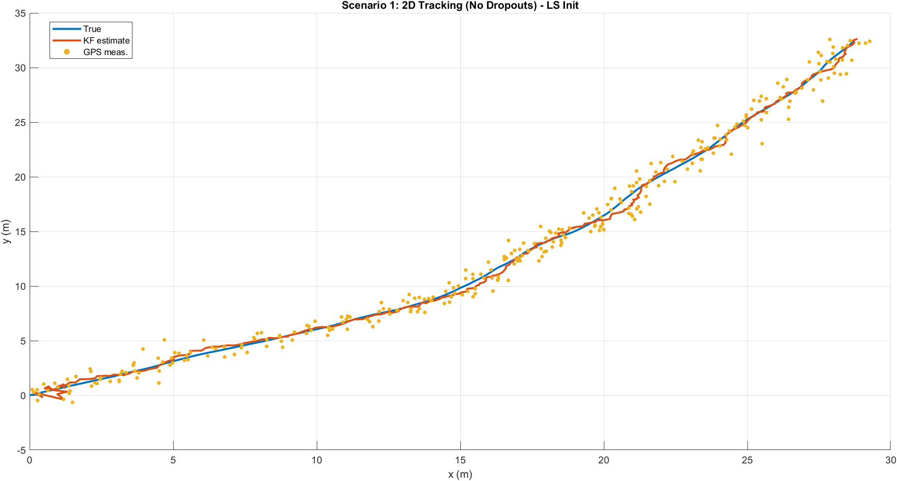
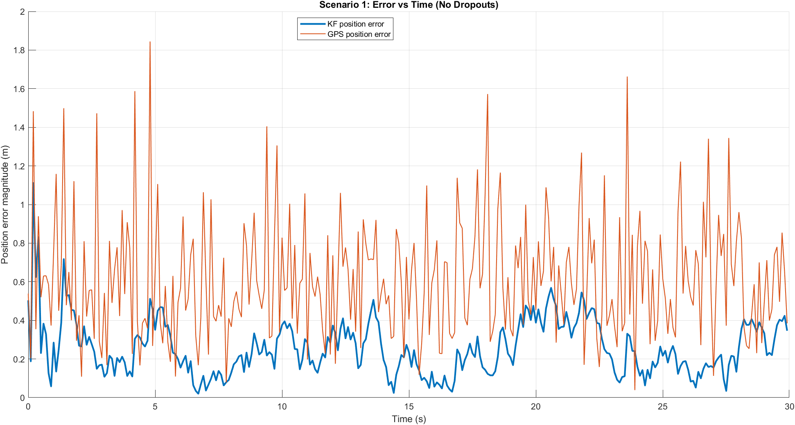
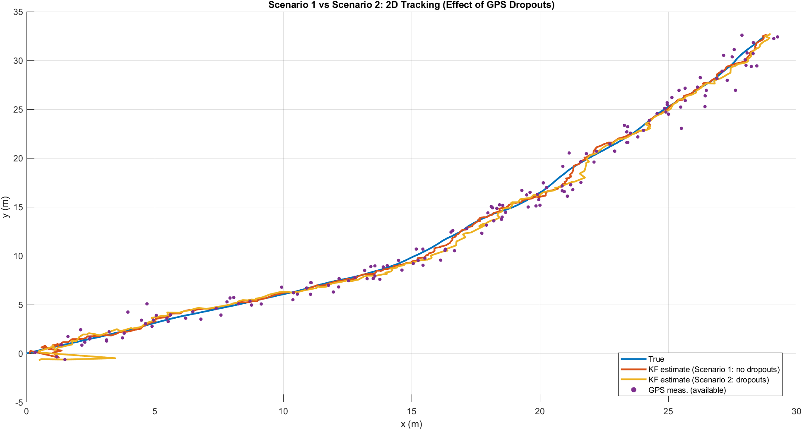

# Kalman Filter for 2D Target Tracking

A linear Kalman filter in MATLAB that estimates a moving target's 2D position **and velocity** from noisy, GPS-like position measurements. It is tested in two scenarios: normal operation, and 50% random GPS dropouts.

| | Raw GPS | Kalman Filter | Improvement |
|---|---|---|---|
| **Scenario 1** – all measurements available | 0.684 m | **0.292 m** | ~57% lower RMSE |
| **Scenario 2** – 50% GPS dropouts | 0.716 m* | **0.504 m** | ~30% lower RMSE |

<sub>*Computed only over the measurements that were available.</sub>



## Problem

Only position is measured, `z = [x, y]`, and the measurements are corrupted by Gaussian noise (σ = 0.5 m). The goal is to estimate the full state `x = [x, y, vx, vy]`, including velocity, which is never measured directly, more accurately than the raw measurements.

## Method

**Motion model: constant velocity.** The target moves under random acceleration disturbances (σₐ = 0.5 m/s²).

```
x_k = F x_{k-1} + w,   F = [1 0 Δt 0; 0 1 0 Δt; 0 0 1 0; 0 0 0 1],   Δt = 0.1 s
```

The process noise `Q` uses the standard white-acceleration model.

**Measurement model:** `z_k = H x_k + v`, with `H = [I₂ 0]` and `R = σ_z² I₂`.

**Filter loop:** the standard predict → update recursion, run for 300 steps (30 s).

**Least-squares initialization:** if the initial velocity is estimated from only two noisy samples, the filter swings noticeably at the start. To reduce this, the initial position and velocity come from a least-squares line fit over the first 10 measurements.

**Handling dropouts (Scenario 2):** when a measurement is missing, the filter runs the prediction step only and skips the update. Its uncertainty grows until the next measurement arrives and corrects the estimate.

## Results

**Scenario 1: position error over time.** The KF error stays well below the raw GPS error throughout the run.



**Scenario 2: effect of 50% GPS dropouts.** The estimate drifts slightly during prediction-only stretches and is pulled back when measurements return.



**Tuning insight:** the ratio of `Q` to `R` sets the trade-off. A larger `Q` makes the filter respond faster to manoeuvres but gives a noisier estimate. A larger `R` gives a smoother estimate but makes it lag behind the true path.

## Running the code

Requires MATLAB; no toolboxes are needed.

Open the `MATLAB_Codes` folder in MATLAB and run:

```matlab
Target_Tracking_2D                 % run first: simulates the target, runs the KF, saves scenario1_data.mat
Target_Tracking_2D_with_Dropouts   % reuses the same trajectory and measurements, then applies dropouts
```

The random seeds are fixed (`rng(7)` and `rng(21)`), so the results above are reproducible.

## Repository structure

```
├── MATLAB_Codes/
│   ├── Target_Tracking_2D.m                 # Scenario 1: KF tracking with all measurements
│   └── Target_Tracking_2D_with_Dropouts.m   # Scenario 2: KF tracking with 50% random GPS dropouts
├── Results/                                 # result plots
└── Report_Mini_Project.pdf                  # full report with derivations and discussion
```

## Limitations and possible extensions

- A small transient remains at the start of the estimate even with least-squares initialization.
- A constant-velocity model cannot fully follow sharp turns or sustained acceleration. Possible extensions are a constant-acceleration or coordinated-turn model, an EKF/UKF for nonlinear measurements (e.g. range and bearing), or an interacting multiple model (IMM) filter.

---

Developed by **Danidu Dabare** as the mini project for EN4594 Autonomous Systems, University of Moratuwa (Dec 2025).
